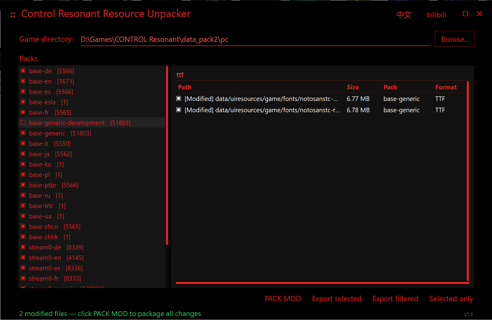
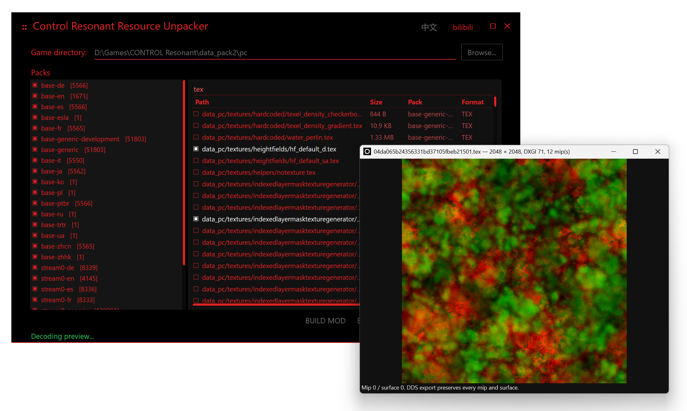

# Control Resonant Resource Unpacker

Windows x64 / .NET 9 WinForms tool for browsing and exporting resources from Control: Resonant Edition archives.

[中文](#中文) · [English](#english) · [GitHub](https://github.com/jakeouyang/ControlResonantResourceUnpacker) · [Releases](https://github.com/jakeouyang/ControlResonantResourceUnpacker/releases)

## 截图 / Screenshots





## 中文

这是一个面向 Windows x64 的 Control: Resonant Edition 资源浏览、导出和开发包制作工具。程序启动时不会读取默认目录，请手动选择包含 `data_pack2/pc` 的游戏目录。

功能：

- 浏览、搜索和导出 RTOC/blob 资源；
- TEX/DDS/常见图片预览，TEX 导出 DDS/PNG；
- WEM 导出 WAV；
- 导出 `ui.ui` 时自动提取内部 SVG、HTML 和 JavaScript，并保留目录结构；
- TTF、TEX 和受支持的静态 BINFBX 导入校验；
- 静态 BINFBX 几何预览、LOD/线框切换和受限 FBX 回导；
- 在游戏目录之外生成 development MOD，不修改原始游戏包；
- 中英文界面、单 EXE 发布、内嵌 `app.ico`。

BINFBX 支持范围请阅读 [FORMAT_RESEARCH.md](FORMAT_RESEARCH.md)。FBX 回导不是通用模型转换器：目前要求保留拓扑、网格名称、材质槽和 UV 层，只支持整体平移、正向等比缩放及整层 UV 变换。骨骼、蒙皮、形态键、动画、局部变形和拓扑重建尚未实现。回导结果已做离线结构校验，但没有游戏内兼容性保证。

### 使用

1. 启动程序并选择游戏目录。
2. 双击 TEX、图片或受支持的静态 BINFBX 进行预览。
3. 右键 TEX/TTF/BINFBX 导入替换文件。
4. 点击“制作 MOD”，确认修改后点击“生成 MOD”，选择游戏目录之外的输出目录。

### UI 图标与网页资源导出（v1.4.0）

搜索 `ui.ui`，选择 `base-generic` 中的 `data/uiresources/game/ui/ui.ui`，再点击“导出选中”。GUI 和命令行导出都会保留原始 `.ui`，并将内部 SVG、HTML 和 JavaScript 自动提取到旁边的 `ui.ui.contents` 文件夹。内部路径保持不变，例如：

```text
<output-directory>/
  base-generic/data/uiresources/game/ui/
    ui.ui
    ui.ui.contents/
      uiresources/game/ui/ui.html
      uiresources/game/ui/globals_island.bundle.js
      uiresources/game/symbols/abilities/icn_ability_astral_summon.svg
```

这些 SVG 嵌在 `.ui` 中，因此不会作为独立条目出现在外层资源列表中；请导出 `ui.ui`，而不是只搜索 `*.svg`。本次实测样本提取出 **728 个 SVG、13 个 HTML 和 5 个 JavaScript**，实际数量随游戏版本而异。

文件内的外部资源引用没有内嵌内容，会跳过且不生成空文件；未知类型的内嵌资源也不会自动写出。外层 `manifest.csv` 会记录成功提取数量、跳过数量和失败原因。未知或损坏的 `.ui` 布局保留原文件；发生磁盘/权限错误或取消导出时，内部提取可能不完整，解决问题后可重新导出。游戏 `.ui` 是二进制 UI 容器，不是 Qt Designer 的 `.ui` 文件；提取后的 HTML/JavaScript 也可能依赖游戏运行环境。这次功能仅支持提取，不支持 UI 容器重新打包或回导。

### 命令行

```powershell
.\RmdblobUnpacker.exe --headless "<game-directory>" "<output-directory>" "*.binfbx"
.\RmdblobUnpacker.exe --headless "<game-directory>" "<output-directory>" "*ui.ui"
```

### 开发与构建

需要 .NET 9 SDK 和 Windows x64 环境：

```powershell
dotnet build -c Release
dotnet run --project Tests/UiBundleChecks.csproj -c Release
dotnet publish -c Release -r win-x64 --self-contained true `
  -p:PublishSingleFile=true -p:IncludeNativeLibrariesForSelfExtract=true `
  -p:DebugType=None -p:DebugSymbols=false -o publish
```

推送 `v*` 标签后，GitHub Actions 会自动构建单 EXE 并创建 GitHub Release。发布包不包含游戏资源、测试样本或本机路径。

第三方许可见 [THIRD-PARTY-NOTICES.txt](THIRD-PARTY-NOTICES.txt)。

UI 解包测试使用合成数据，无需游戏文件。可在测试命令后加上 `-- --game-dir "<game-directory>"`，追加本机已安装游戏的验证；不要将导出的游戏数据提交到仓库。

## English

Control Resonant Resource Unpacker is a Windows x64 / .NET 9 WinForms tool for browsing and exporting resources from Control: Resonant Edition archives. It does not load a default directory on startup; select a game directory containing `data_pack2/pc`.

Features include archive browsing and search, TEX/DDS/image preview, TEX export, WEM-to-WAV export, validated TTF/TEX/static-BINFBX replacement imports, static BINFBX geometry preview, restricted FBX round-trip editing, and development MOD packaging outside the game directory. The release executable is self-contained and includes `app.ico`.

### UI icons, HTML and JavaScript (v1.4.0)

Search for `ui.ui`, select `data/uiresources/game/ui/ui.ui` from `base-generic`, and choose **Export selected**. Both GUI and CLI exports keep the original container and automatically extract embedded `.svg`, `.html` and `.js` files to the adjacent `ui.ui.contents/` directory, preserving internal paths:

```text
base-generic/data/uiresources/game/ui/ui.ui
base-generic/data/uiresources/game/ui/ui.ui.contents/uiresources/game/ui/ui.html
base-generic/data/uiresources/game/ui/ui.ui.contents/uiresources/game/ui/globals_island.bundle.js
base-generic/data/uiresources/game/ui/ui.ui.contents/uiresources/game/symbols/abilities/icn_ability_astral_summon.svg
```

The SVGs are nested inside `.ui`, so they are not separate entries in the outer archive browser. Export `ui.ui` rather than filtering only for `*.svg`. The tested build contains **728 SVGs, 13 HTML files and 5 JavaScript files**; counts may differ between game versions.

External references contain no embedded bytes and are skipped without creating empty placeholders. Other embedded file types are also skipped. The outer `manifest.csv` reports extracted/skipped counts or failure details. Unsupported or malformed bundles retain their original `.ui`; disk/permission errors or cancellation can leave an incomplete nested export, which can be retried. This binary game container is unrelated to Qt Designer's `.ui` format. Extracted HTML/JavaScript may depend on the game runtime. UI bundle re-import/repacking is not supported.

```powershell
.\RmdblobUnpacker.exe --headless "<game-directory>" "<output-directory>" "*ui.ui"
```

### Build and checks

On Windows with the .NET 9 SDK, run `dotnet build -c Release` and `dotnet run --project Tests/UiBundleChecks.csproj -c Release`. Tests use synthetic fixtures and do not require game assets. To additionally check a locally installed game, append `-- --game-dir "<game-directory>"` to the test command. Source build/publish commands are shown in the Chinese section above.

See [FORMAT_RESEARCH.md](FORMAT_RESEARCH.md) for the BINFBX support boundary. FBX re-import is intentionally conservative: preserve mesh names, topology, material slots and UV layers; whole-model translation, positive uniform scale and whole-layer UV transforms are supported. Skeletons, skinning, blend shapes, animation, local deformation and topology rebuild are not implemented. Offline validation does not guarantee in-game compatibility.

Pushing a `v*` tag runs GitHub Actions, builds a single-file Windows executable and attaches it to a GitHub Release. Game data, samples and machine-specific paths are excluded from the repository.

See [THIRD-PARTY-NOTICES.txt](THIRD-PARTY-NOTICES.txt) for dependency licenses.
